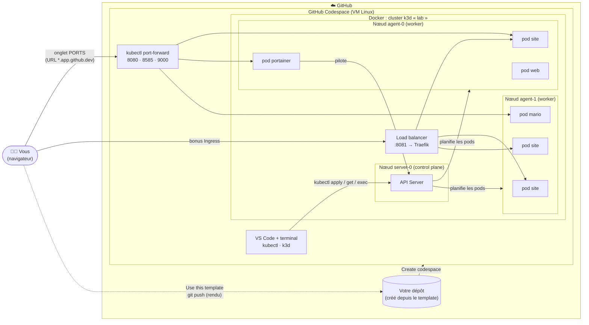

# Atelier Kubernetes 2026

> **Public :** M2 Informatique · **Prérequis :** bases Linux et Docker, un compte GitHub

Pendant cet atelier, vous allez monter un **vrai cluster Kubernetes** (1 master et 2 workers) dans votre navigateur, y déployer des applications, d'abord à la main, puis « comme en production » avec des manifestes YAML, et enfin le piloter depuis une interface graphique (Portainer).

### Architecture de l'atelier



Le schéma se lit en trois couches :

- **GitHub** : vous créez votre dépôt à partir de ce template, puis un **Codespace**, c'est-à-dire une machine Linux dans le cloud avec VS Code dans le navigateur.
- **Docker** : dans ce Codespace, **k3d** lance un cluster Kubernetes dont chaque **nœud est un conteneur Docker** : 1 *control plane* et 2 *workers*.
- **Kubernetes** : vous pilotez le cluster avec `kubectl`, puis avec **Portainer**, qui lui-même tourne *dans* le cluster. L'**API Server** répartit les pods sur les workers, et vos applications sont rendues accessibles par `port-forward` ou par l'Ingress (bonus).

> La répartition des pods sur les nœuds est indicative : c'est Kubernetes qui décide où les placer (vous le vérifierez à l'exercice 5).

### Objectifs pédagogiques

À la fin de l'atelier, vous saurez :

- expliquer le rôle des **nœuds**, **pods**, **Deployments** et **Services** ;
- déployer une application de manière **impérative** (`kubectl create`) puis **déclarative** (`kubectl apply -f`) ;
- constater la **résilience** de Kubernetes (auto-réparation) et le caractère **éphémère** des conteneurs ;
- **mettre à l'échelle**, **mettre à jour** et **revenir en arrière** (rollback) sans interruption de service ;
- **diagnostiquer** un pod en erreur ;
- piloter le cluster depuis **Portainer**.

### Déroulé

| # | Exercice | Notions | Durée |
|---|----------|---------|-------|
| 0 | [Mise en place](#exercice-0--mise-en-place) | Template GitHub, Codespaces, installation de k3d | 10 min |
| 1 | [Créer le cluster](#exercice-1--créer-le-cluster) | k3d, nœuds, `kubectl` | 15 min |
| 2 | [Premier déploiement](#exercice-2--premier-déploiement-impératif) | Deployment, Service, port-forward, auto-réparation | 25 min |
| 3 | [Modifier un conteneur en direct](#exercice-3--modifier-un-conteneur-en-direct) | `exec`, conteneurs éphémères | 15 min |
| 4 | [Passer au déclaratif](#exercice-4--passer-au-déclaratif) | YAML, ConfigMap, volumes, `apply` | 35 min |
| 5 | [Scaling et mises à jour](#exercice-5--scaling-mises-à-jour-et-pannes) | replicas, rolling update, rollback, debug | 30 min |
| 6 | [Portainer et Mario](#exercice-6--piloter-le-cluster-avec-portainer) | interface graphique, namespaces | 30 min |
| ★ | [Bonus](#bonus) | Ingress, probes, drain d'un nœud | libre |

Chaque exercice se termine par des **questions** auxquelles vous répondez dans [`RENDU.md`](RENDU.md). À tout moment, vérifiez votre avancement :

```bash
./scripts/check.sh
```

---

## Exercice 0 : mise en place

### 0.1 Créer votre propre dépôt (« Use this template »)

1. En haut de cette page GitHub, cliquez sur **`Use this template`** puis **`Create a new repository`**.
2. **Owner** : votre compte, **Repository name** : `atelier-kubernetes` (par exemple), visibilité **Public**.
3. Cliquez sur **`Create repository`**.

Vous travaillez désormais dans **votre** copie. C'est elle que vous rendrez à la fin.

### 0.2 Ouvrir un Codespace

1. Dans **votre** dépôt : **`Code`**, onglet **`Codespaces`**, puis **`Create codespace on main`**.
2. VS Code s'ouvre dans le navigateur, avec un terminal Linux en bas. Docker et `kubectl` sont déjà installés.

> [!TIP]
> Si votre compte le permet, préférez une machine **4 cœurs** : `Code`, `Codespaces`, `…`, puis `New with options…` et `Machine type`. Une machine 2 cœurs suffit cependant pour l'atelier.

### 0.3 Installer k3d

```bash
curl -s https://raw.githubusercontent.com/k3d-io/k3d/main/install.sh | bash
```

Optionnel mais pratique : un alias `k` pour `kubectl`, avec l'autocomplétion.

```bash
cat >> ~/.bashrc <<'EOF'
source <(kubectl completion bash)
alias k=kubectl
complete -o default -F __start_kubectl k
EOF
source ~/.bashrc
```

Vérifiez que tout est prêt :

```bash
k3d version
kubectl version --client
docker ps
```

---

## Exercice 1 : créer le cluster

Un vrai cluster Kubernetes demande plusieurs machines. **k3d** simule chaque nœud par un **conteneur Docker** qui exécute **k3s**, une distribution Kubernetes légère et certifiée.

```bash
k3d cluster create lab \
  --servers 1 \
  --agents 2 \
  -p "8081:80@loadbalancer"
```

- `--servers 1` : un nœud *control plane* (le « master »)
- `--agents 2` : deux nœuds *workers*
- `-p "8081:80@loadbalancer"` : relie le port 8081 du Codespace au load balancer du cluster (utile pour le [bonus A](#a--ingress-une-vraie-entrée-http))

Explorez :

```bash
kubectl get nodes -o wide
kubectl cluster-info
docker ps --format "table {{.Names}}\t{{.Image}}\t{{.Status}}"
```

**À vous :**
- Repérez dans `kubectl get nodes` le nœud `control-plane` et les deux workers.
- Comparez avec la sortie de `docker ps` : à quoi correspond chaque nœud ?
- Lancez `kubectl get pods -A` : quels pods tournent **déjà** sur un cluster « vide » ? Dans quel namespace ?

📝 *Répondez aux questions 1 et 2 de [`RENDU.md`](RENDU.md).*

---

## Exercice 2 : premier déploiement (impératif)

### 2.1 Déployer nginx

```bash
kubectl create deployment web --image=nginx
kubectl expose deployment web --port=80
kubectl get all
```

> [!TIP]
> Si vous avez créé l'alias à l'étape 0.3, `k` remplace `kubectl`, et la touche <kbd>Tab</kbd> complète les commandes et les noms de ressources.

### 2.2 Accéder au site

Le Service n'est joignable que **depuis l'intérieur** du cluster. Pour y accéder depuis votre navigateur, créez un tunnel :

```bash
kubectl port-forward svc/web 8080:80 > /tmp/web.log 2>&1 &
```

Ouvrez l'onglet **`PORTS`** de VS Code (à côté du terminal) et cliquez sur l'icône 🌐 du port **8080** : la page *Welcome to nginx!* s'affiche.

> [!IMPORTANT]
> **Relancer un tunnel proprement.** Un `port-forward` échoue (`Exit 1`) si un ancien tunnel occupe encore le port, ou si le pod n'est pas encore prêt. La cause s'affiche dans `/tmp/web.log`. Pour relancer, utilisez toujours ces trois commandes :
> ```bash
> pkill -f "port-forward svc/web"            # 1. couper l'ancien tunnel
> kubectl rollout status deploy/web          # 2. attendre que le pod soit prêt
> kubectl port-forward svc/web 8080:80 > /tmp/web.log 2>&1 &   # 3. relancer
> ```

### 2.3 Casser pour comprendre

Dans un **second terminal** (bouton `+` du terminal), observez les pods en temps réel :

```bash
kubectl get pods -w
```

Dans le premier terminal, supprimez le pod (remplacez le nom par le vôtre, ou utilisez le label) :

```bash
kubectl delete pod -l app=web
```

**À vous :** que voyez-vous dans le second terminal ? Le nom du pod a-t-il changé ?

<details>
<summary>💡 Explication</summary>

Vous n'avez pas créé un *pod* mais un **Deployment**, qui crée un **ReplicaSet** chargé de maintenir *N* pods en vie. Dès qu'un pod disparaît, le ReplicaSet en recrée un : c'est la **boucle de réconciliation** (état désiré contre état réel), au cœur de Kubernetes.
</details>

📝 *Questions 3 et 4.*

---

## Exercice 3 : modifier un conteneur en direct

Changeons la page d'accueil **directement dans le conteneur** :

```bash
kubectl exec -it deploy/web -- bash
```

```bash
# Vous êtes maintenant DANS le conteneur nginx
echo "<h1>Bienvenue sur mon site Web</h1>" > /usr/share/nginx/html/index.html
exit
```

Le tunnel a cassé à l'exercice 2.3. Relancez-le, puis rechargez la page du port 8080 :

```bash
pkill -f "port-forward svc/web"
kubectl rollout status deploy/web
kubectl port-forward svc/web 8080:80 > /tmp/web.log 2>&1 &
```

Ça fonctionne ! Maintenant, supprimez à nouveau le pod :

```bash
kubectl delete pod -l app=web
```

**À vous :**
- Rechargez la page. Que se passe-t-il ? Consultez `/tmp/web.log`.
- Relancez le tunnel (les trois commandes ci-dessus). Votre message est-il toujours là ?

<details>
<summary>💡 Explication</summary>

- Un `port-forward` vers un Service s'attache en réalité à **un seul pod**. Si ce pod meurt, le tunnel casse.
- Le système de fichiers d'un conteneur est **éphémère** : le nouveau pod repart de l'image `nginx` d'origine. Modifier un conteneur à la main, c'est perdre son travail au prochain redémarrage.

Il faut donc **décrire** ce que l'on veut (le contenu du site compris) **en dehors** du conteneur. C'est l'objet de l'exercice suivant.
</details>

📝 *Questions 5 et 6.*

---

## Exercice 4 : passer au déclaratif

En production, on n'enchaîne pas des commandes à la main : on **décrit l'état désiré** dans des fichiers YAML, versionnés dans Git, et Kubernetes s'occupe d'y parvenir.

Le dossier [`k8s/site/`](k8s/site/) contient trois manifestes **à compléter** :

| Fichier | Rôle |
|---------|------|
| [`configmap.yaml`](k8s/site/configmap.yaml) | le contenu de `index.html`, stocké dans le cluster (complet, à personnaliser) |
| [`deployment.yaml`](k8s/site/deployment.yaml) | les pods nginx, qui montent la ConfigMap comme dossier web |
| [`service.yaml`](k8s/site/service.yaml) | l'adresse stable vers ces pods |

### 4.1 Compléter les manifestes

Remplacez tous les `TODO`. Pour vous aider :

```bash
kubectl explain deployment.spec.template.spec.containers.volumeMounts
kubectl get deploy web -o yaml     # comparez avec ce que "create" a généré !
```

<details>
<summary>💡 Indice : le dossier servi par nginx</summary>

C'est le dossier que vous avez modifié à l'exercice 3.
</details>

<details>
<summary>💡 Indice : les labels</summary>

Un Deployment retrouve ses pods, et un Service ses cibles, grâce aux **labels**. Le `selector` doit correspondre exactement aux `labels` du `template` des pods.
</details>

### 4.2 Appliquer

```bash
kubectl apply -f k8s/site/
kubectl get deploy,pods,svc,configmap
```

Arrêtez l'ancien tunnel et ouvrez-en un vers le nouveau site :

```bash
pkill -f "kubectl port-forward"
kubectl rollout status deploy/site
kubectl port-forward svc/site 8080:80 > /tmp/site.log 2>&1 &
```

Votre page personnalisée doit s'afficher sur le port 8080.

### 4.3 Vérifier la persistance

```bash
kubectl delete pod -l app=site
```

Relancez le tunnel, puis rechargez la page. Cette fois, votre page **survit**.

```bash
pkill -f "port-forward svc/site"
kubectl rollout status deploy/site
kubectl port-forward svc/site 8080:80 > /tmp/site.log 2>&1 &
```

### 4.4 Modifier le site, version déclarative

Modifiez le texte dans `configmap.yaml`, puis :

```bash
kubectl apply -f k8s/site/
```

> [!NOTE]
> La mise à jour d'une ConfigMap montée en volume peut mettre **jusqu'à une minute** à apparaître dans les pods. Pour forcer : `kubectl rollout restart deploy/site`.

**Si ça ne marche pas**, voici votre trousse de diagnostic :

```bash
kubectl get pods                    # statut : Running ? Pending ? CrashLoopBackOff ?
kubectl describe pod -l app=site    # section "Events" en bas : la cause est souvent là
kubectl logs -l app=site            # logs de nginx
kubectl get endpoints site          # le Service trouve-t-il des pods ?
```

📝 *Questions 7 et 8.*

---

## Exercice 5 : scaling, mises à jour et pannes

Gardez `kubectl get pods -o wide -w` ouvert dans un second terminal pendant tout l'exercice.

### 5.1 Passer à l'échelle

Dans `deployment.yaml`, passez `replicas` à **3**, puis appliquez :

```bash
kubectl apply -f k8s/site/
kubectl get pods -l app=site -o wide
```

**À vous :** sur quels nœuds Kubernetes a-t-il placé les pods ?

### 5.2 Mise à jour sans coupure (rolling update)

Dans `deployment.yaml`, changez l'image `nginx:1.27` en `nginx:1.28`, puis :

```bash
kubectl apply -f k8s/site/
kubectl rollout status deploy/site
kubectl rollout history deploy/site
```

Observez dans le second terminal : les pods sont remplacés **un par un**, jamais tous en même temps.

### 5.3 Déployer une version cassée

Une mise en production ratée, ça arrive :

```bash
kubectl set image deploy/site nginx=nginx:9.99
kubectl get pods -l app=site
```

**À vous :**
1. Quel est le statut du nouveau pod ? **Trouvez la cause exacte** avec les commandes de diagnostic de l'exercice 4.
2. Pendant ce temps, rechargez votre site : est-il toujours en ligne ?
3. Revenez à la version précédente :

```bash
kubectl rollout undo deploy/site
kubectl rollout status deploy/site
```

> [!IMPORTANT]
> `kubectl set image` est une commande **impérative** : votre fichier YAML ne reflète plus ce qui tourne réellement. Après le `undo`, vérifiez avec `kubectl diff -f k8s/site/` que le cluster et vos fichiers sont de nouveau alignés. En entreprise, **le dépôt Git fait foi** (c'est le principe du *GitOps*).

📝 *Questions 9, 10 et 11.*

---

## Exercice 6 : piloter le cluster avec Portainer

[Portainer](https://www.portainer.io/) est une interface web pour gérer Docker et Kubernetes.

### 6.1 Installer Portainer dans le cluster

```bash
kubectl apply -n portainer -f https://downloads.portainer.io/ce-lts/portainer.yaml
kubectl get pods -n portainer -w      # attendez "1/1 Running", puis Ctrl+C
kubectl port-forward -n portainer svc/portainer 9000:9000 > /tmp/portainer.log 2>&1 &
```

Ouvrez le port **9000** depuis l'onglet `PORTS`.

> [!WARNING]
> Pour des raisons de sécurité, Portainer **se verrouille si aucun compte admin n'est créé dans les 5 minutes**. Si vous voyez un message de *timeout* :
> ```bash
> kubectl rollout restart deploy/portainer -n portainer
> ```
> puis relancez le port-forward.

1. Créez le compte **admin** (mot de passe de 12 caractères minimum).
2. Cliquez sur **Get Started** : l'environnement **local** (votre cluster) est détecté automatiquement, car Portainer tourne *dans* le cluster avec les droits nécessaires.
3. Explorez : retrouvez vos **nœuds**, le Deployment `site` et ses 3 pods, la ConfigMap `site-html`.

### 6.2 Déployer Super Mario depuis Portainer

1. Sélectionnez l'environnement **local**.
2. Menu **Applications**, puis **Create from manifest** (ou *Create from code*, selon la version).
3. Namespace : `default`. Méthode : **Web editor**.
4. Collez le contenu de [`k8s/mario/mario.yaml`](k8s/mario/mario.yaml).
5. Cliquez sur **Deploy**.

Ouvrez ensuite le tunnel vers Mario :

```bash
kubectl port-forward svc/mario 8585:85 > /tmp/mario.log 2>&1 &
```

### 6.3 Partager votre Mario 🍄

Dans l'onglet `PORTS` : **clic droit sur le port 8585**, puis **Port Visibility** et **Public**.

Copiez l'URL (de la forme `https://<nom-du-codespace>-8585.app.github.dev/`), ouvrez-la dans une fenêtre de navigation privée pour vérifier qu'elle est bien publique, puis :
- collez-la dans [`RENDU.md`](RENDU.md) (question 12),
- et partagez-la sur le canal indiqué par votre enseignant.

**À vous :** lancez `kubectl get deploy mario -o yaml`. Le Deployment créé par Portainer est-il différent de ceux que vous avez créés en ligne de commande ?

📝 *Questions 12 et 13.*

---

## Bonus

Pour ceux qui ont fini en avance, ou qui veulent aller plus loin. Chaque bonus est vérifié par `./scripts/check.sh`.

### A : Ingress, une vraie entrée HTTP

Les `port-forward` sont pratiques mais fragiles (vous l'avez vu à l'exercice 3). En production, on utilise un **Ingress Controller**. k3s embarque **Traefik**, déjà relié au port 8081 grâce à l'option `-p` de l'exercice 1.

Complétez [`k8s/bonus/ingress.yaml`](k8s/bonus/ingress.yaml), appliquez-le, puis ouvrez le port **8081**. Supprimez ensuite des pods : le site reste-t-il accessible cette fois ?

### B : Probes et ressources

Ajoutez au conteneur de `deployment.yaml` :
- une `readinessProbe` HTTP sur `/` (port 80) : Kubernetes n'enverra du trafic qu'aux pods prêts ;
- des `resources.requests` et `resources.limits` (par exemple 50m/100m de CPU et 32Mi/64Mi de mémoire).

Consultez `kubectl explain deployment.spec.template.spec.containers.readinessProbe`. Que se passe-t-il si la probe pointe vers un chemin qui n'existe pas (`/nope`) ?

### C : Maintenance d'un nœud

Simulez la maintenance d'un worker :

```bash
kubectl drain k3d-lab-agent-0 --ignore-daemonsets --delete-emptydir-data
kubectl get pods -o wide
kubectl uncordon k3d-lab-agent-0
```

Où sont passés les pods ? Reviennent-ils tout seuls après le `uncordon` ? Pourquoi ?

### D : Namespaces

Créez un namespace `prod`, déployez-y une seconde copie du site (`kubectl apply -n prod -f k8s/site/`) et observez l'isolation dans Portainer.

---

## Rendu

1. Vérifiez votre score : `./scripts/check.sh`, et notez-le en bas de `RENDU.md`.
2. Poussez votre travail sur **votre** dépôt :

```bash
git add k8s/ RENDU.md
git commit -m "Rendu atelier Kubernetes"
git push
```

3. Transmettez l'URL de votre dépôt GitHub à votre enseignant.
4. **Arrêtez votre Codespace.**

---

## Aide-mémoire

| Besoin | Commande |
|--------|----------|
| Lister les ressources | `kubectl get pods,deploy,svc` (`-o wide`, `-A`, `-w`) |
| Détail et événements | `kubectl describe <type> <nom>` |
| Logs | `kubectl logs <pod>` · `kubectl logs -l app=site` |
| Shell dans un conteneur | `kubectl exec -it <pod> -- sh` |
| Appliquer des manifestes | `kubectl apply -f <fichier ou dossier>` |
| Écart fichier / cluster | `kubectl diff -f <fichier>` |
| Documentation d'un champ | `kubectl explain deployment.spec` |
| Historique / rollback | `kubectl rollout history deploy/<nom>` · `kubectl rollout undo deploy/<nom>` |
| Lister les tunnels | `pgrep -af port-forward` |
| Couper les tunnels | `pkill -f "kubectl port-forward"` |
| État des clusters k3d | `k3d cluster list` |
| Supprimer le cluster | `k3d cluster delete lab` |

## Dépannage

| Symptôme | Piste |
|----------|-------|
| `The connection to the server ... was refused` | Le cluster est arrêté (Codespace redémarré ?) : `k3d cluster start lab` |
| La page ne s'affiche plus | Le port-forward est mort : `pgrep -af port-forward`, puis relancez-le |
| `ImagePullBackOff` / `ErrImagePull` | Nom ou tag d'image incorrect : `kubectl describe pod ...` |
| `CrashLoopBackOff` | L'application plante au démarrage : `kubectl logs <pod> --previous` |
| Pod `Pending` | Pas assez de ressources ou contrainte impossible : `kubectl describe pod ...` |
| Portainer affiche un *timeout* | `kubectl rollout restart deploy/portainer -n portainer` |
| Tout recommencer | `k3d cluster delete lab`, puis reprendre l'exercice 1 |
